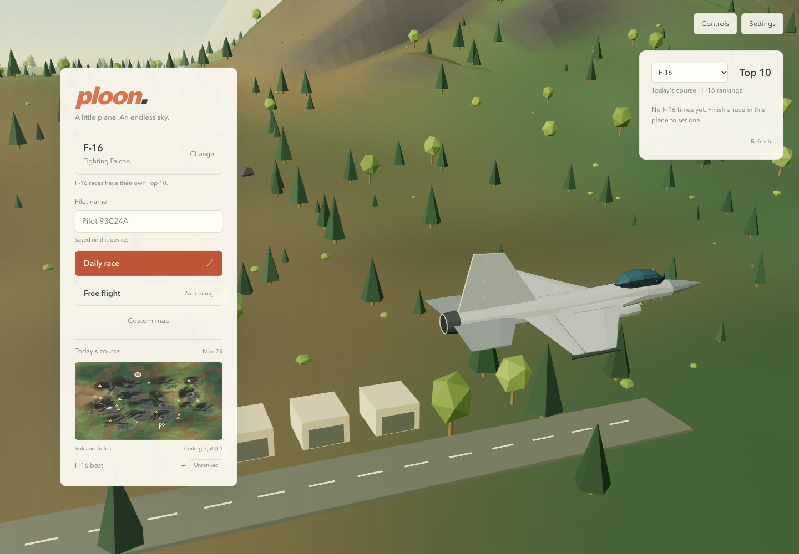

# Ploon

A little plane. An endless sky. A desktop browser flying game with daily mountain races, free flight, and a procedurally generated low-poly world.



Fly eight aircraft, from the Cessna 172 to the F-35. Find your own route to the finish, race your personal ghost, and compete on per-aircraft leaderboards. Customize your plane and cockpit, or enter **Maverik** in Custom map for a trench run.

## Run

Requires **Node.js 22+**.

```sh
npm install
npm start
```

Open **http://localhost:3000**. Choose an aircraft, then **Daily race**, **Free flight**, or **Custom map**. Use `npm run dev` for server auto-restart; refresh after frontend changes. Set `HOST=0.0.0.0` to play from another device.

## Controls

| Keys | Action |
| --- | --- |
| W / S or ↑ / ↓ | Pitch down / up |
| A / D or ← / → | Roll left / right |
| Q / E | Yaw left / right |
| Shift / Ctrl | Increase / decrease throttle |
| Hold Shift at full throttle | Afterburner on equipped fighters |
| Hold Space | Air drift / airbrake; brake on the ground |
| C / H | Switch camera / toggle HUD |
| G | Landing gear in free flight; ghost in races |
| R / Escape | Restart / pause |

Bank to turn. In races, fly through the finish ring and stay below the marked ceiling. Free flight has no ceiling and supports landings. Settings includes units, audio, and HUD options. Progress and customization save in your browser.

## Development

Vanilla HTML, CSS, JavaScript, and Three.js, with a Node.js backend. No build step.

```sh
npm test
```

Shared scores are replay-verified and saved to `data/leaderboards.json`. Set `LEADERBOARD_FILE` to use a persistent volume. `PORT` and `HOST` configure the server.

See [aircraft model notes](docs/aircraft-models.md) for modeling references.
